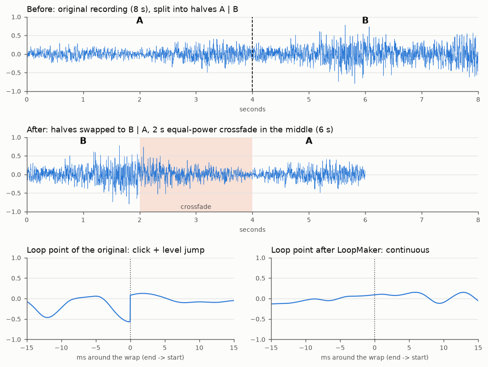

# Loop Maker

Turn ambience recordings into **seamlessly loopable** audio files, the same way a
sound designer does it by hand in a DAW, but in batch, with a quality check.



*Synthetic example (filtered noise with a level drift; see
[`scripts/make_readme_figure.py`](scripts/make_readme_figure.py)). Top: the original
file. Middle: the Loop Maker output. Bottom: what you hear at the loop point when
each file wraps around from its end back to its start.*

## Why

Game audio engines loop ambience beds constantly. If a recording is looped as-is, its
end and start rarely match, which causes a click (a sample jump) and often an audible
change in level or texture every time the loop wraps. The classic manual fix is the
"swap halves and crossfade" edit. Loop Maker automates it.

## How it works

```
original:   [ A ......... | B ......... ]         (split at the midpoint)
swapped:    [ B ......... | A ......... ]         (old end now meets old start in the middle)
crossfade:  [ B ....  \/\/\/  .... A ]            (overlap B's tail with A's head)
```

1. Split the file in half: **A** (first half) and **B** (second half).
2. Swap them: **B | A**. The new file **starts** at the old midpoint and **ends** just
   before it. Those two samples were neighbours in the original recording, so the
   new loop point is naturally continuous: no edit happens there at all.
3. The only seam is now in the middle, where the old end meets the old start. It is
   hidden with a crossfade: the last *C* seconds of B fade out while the first *C*
   seconds of A fade in. Because those regions overlap, **the output is *C* seconds
   shorter than the input**.
4. A tiny optional safety fade (default 5 ms) is applied at the very start and end.

### Crossfade curves

| Curve | Gains | Use for |
|---|---|---|
| `auto` (default) | picks one of the two below per file | Any material; see below. |
| `equal_power` | sin / cos, `out² + in² = 1` | Uncorrelated material: ambience, room tone, wind, rain. Keeps perceived loudness constant. |
| `linear` | straight ramps, `out + in = 1` | Correlated material (e.g. steady tones/hums), where equal power would bump the level by up to +3 dB. |

#### How `auto` decides

Using the wrong curve makes the middle of the crossfade audibly **dip** (linear on
noise, about −3 dB) or **bulge** (equal power on a steady tone, about +3 dB). `auto`
measures the **zero-lag correlation *r*** between the two signals that will actually be
crossfaded: the file's end and the file's start, sample-aligned exactly as they will
overlap. The measurement is Hann-weighted toward the centre of the crossfade, where both
gains are large, and pooled across channels so every channel gets the same curve.

At the centre of the crossfade the summed power relative to the input is `1 + r` for
equal power and `(1 + r) / 2` for linear. The two errors are equal in dB when
`(1 + r)² = 2`, so the threshold is **r = √2 − 1 ≈ 0.41**: above it `linear`, below it
`equal_power`.

It measures correlation rather than asking "is this tonal?" on purpose: two hums that
meet 90° out of phase are tonal but add like noise, so equal power is the right call
for them, and the measurement gets that right. The chosen curve and *r* appear in every
report.

### Loudness normalization (batch)

With `--normalize -24` (or the GUI checkbox), every output in the batch is brought to the
same **integrated loudness** (ITU-R BS.1770-4 / EBU R128, via
[pyloudnorm](https://github.com/csteinmetz1/pyloudnorm)), so a set of ambience beds
arrives in Wwise/FMOD/engine already level-matched.

- Measured on the **finished loop**, the exact audio that will play in the game.
- One static gain per file. No limiter or compressor touches the sound.
- **True-peak ceiling** (default −1 dBTP, estimated with 4x oversampling): if reaching the
  target would exceed it, the gain stops at the ceiling and the report says how many dB
  the file fell short. To keep such a file consistent with the rest, lower the batch
  target.
- 5.1 files are measured without the LFE channel, as BS.1770 specifies. Layouts with more
  than 6 channels, silent files, and files shorter than 400 ms are written un-normalised
  with a note.
- Off by default. The −23 LUFS default target in the GUI is the EBU R128 reference.
  Pick whatever your project's asset loudness spec says.

### Loop quality report

After each file, Loop Maker prints a small report comparing the **original** (as if
it were looped untouched) with the **output**. Both are measured before loudness
normalisation, so their levels are directly comparable:

```
wind_quiet.wav -> output\wind_quiet_loop.wav
  48000 Hz, 2 ch, PCM_24 -> PCM_24, 12.000 s -> 10.000 s
  Crossfade curve: equal_power (auto; end/start correlation +0.02, threshold 0.41)
  Loudness: -31.8 -> -24.0 LUFS (gain +7.8 dB, true peak -10.4 dBTP)
  Loop-point check (window 50 ms): SMOOTH
  original  jump 0.03541 (40.19x typical step)   RMS head/tail  -32.5 /  -32.3 dBFS (diff -0.23 dB)
  loop      jump 0.00000 ( 0.00x typical step)   RMS head/tail  -32.6 /  -31.3 dBFS (diff -1.38 dB)
```

- **jump**: `|first sample - last sample|` (max over channels), and that value divided by
  the file's *typical step* (99th percentile of sample-to-sample differences). ≤ 1x means
  the wrap is no bigger than an ordinary step inside the recording.
- **RMS head/tail**: level of the first and last 50 ms (configurable). A large difference
  means an audible level jump at the wrap.
- **Verdict**: `SMOOTH` when jump ratio ≤ 1.0 and |RMS diff| ≤ 2 dB, otherwise
  `CHECK BY EAR`. These are simple heuristics, not a perceptual model.

## Install

Requires Python 3.10+ (developed on 3.12, Windows 11).

```bash
python -m venv .venv
```

```bash
.venv\Scripts\activate
```

```bash
pip install -r requirements.txt
```

`tkinterdnd2` and `sounddevice` are optional; without them the GUI falls back to the
*Add files* / *Add folder* buttons and a waveform-only test area. `matplotlib` and `pytest` are only needed for the figure and tests.

## Usage

### Command line

```bash
python -m loopmaker rain.wav forest.flac --crossfade 3.0 --curve equal_power --out output
```

```bash
python -m loopmaker "D:\Recordings\Ambience"
```

| Option | Default | Meaning |
|---|---|---|
| `inputs` | (required) | Files and/or folders. Folders are scanned non-recursively for `.wav .flac .aif .aiff .ogg`. |
| `--crossfade SECONDS` | `2.0` | Crossfade length. Must be > 0 and ≤ half the file length. |
| `--curve` | `auto` | `auto`, `equal_power` or `linear`. |
| `--normalize LUFS` | off | Bring every output to this integrated loudness, e.g. `-24`. |
| `--peak-ceiling DBTP` | `-1` | True-peak ceiling for `--normalize`. |
| `--safety-fade MS` | `5` | Start/end fade in milliseconds; `0` disables it. |
| `--out FOLDER` | `output` | Output folder (created if needed). |
| `--report-window MS` | `50` | Window used by the quality report. |

Exit code is `0` when every file succeeded, `1` if any file failed or was skipped.

### GUI

On Windows, double-click **`Loop Maker.bat`** in the project folder (it starts the GUI
from the project's `.venv` without a console window). Or from a terminal:

```bash
.venv\Scripts\python.exe -m loopmaker.gui
```

Drag files or folders onto the list (or use the buttons), set the crossfade, curve,
safety fade and output folder, then press **Process**. The log shows the same quality
report as the CLI. The GUI calls exactly the same `pipeline.process_batch()` as the CLI.

**Test playback.** After processing, every output appears in the *Test playback* list
with its verdict. Select one to see its waveform; the crossfade region is highlighted
in orange.

| Action | Effect |
|---|---|
| **Space** or **Play/Stop** | Start/stop looping playback (resumes where it stopped) |
| **Left-click the waveform** | Play from that point (jumps there if already playing) |
| **Play loop point** | Start 2 s before the end, so you hear the wrap straight away |
| **Open output folder** | Show the files in Explorer |

Playback wraps from the last sample straight into the first, exactly like a game
engine's looping voice, so what you hear is a true test of the loop point. Mono files
play on both speakers; files with more channels than the output device are folded to
mono for auditioning only (the written file is untouched). Playback needs the optional
`sounddevice` package; without it the waveform still works.

### As a library

```python
import soundfile as sf
from loopmaker.core import make_loop

audio, sr = sf.read("wind.wav")          # (frames,) or (frames, channels)
looped = make_loop(audio, sr, crossfade_s=3.0, curve="equal_power", safety_fade_s=0.005)
```

## Output files

- Written as `<output folder>/<name>_loop.wav`. **The input is never overwritten**
  (this is checked explicitly before writing).
- Sample rate and channel count are always preserved.
- Bit depth is preserved: PCM 8/16/24/32-bit and 32/64-bit float WAV/FLAC/AIFF inputs
  are written with the same WAV subtype. Inputs with no lossless WAV equivalent (e.g. Ogg
  Vorbis) are written as 24-bit PCM, and the report says so.

## Design decisions and defaults

Choices I made where the spec left room. They are easy to change.

- **Output is always WAV**, even for FLAC input, because WAV is what game engines and
  middleware import most directly.
- **Default crossfade is 2.0 s.** Long enough to hide the seam in most ambience,
  short enough to work on files of 4 s and up.
- **Crossfade must be > 0.** A 0 s crossfade would leave a hard cut in the middle,
  which defeats the purpose.
- **Odd-length files**: the extra sample goes to B, so the crossfade limit is
  `floor(frames / 2)` samples.
- **Existing outputs are overwritten** (re-running with new settings is the common
  case). Within one batch, name collisions (e.g. `rain.wav` and `rain.flac`) get
  `_loop_2`, `_loop_3`, ...
- **Folders are scanned non-recursively**, so the output folder is never picked up as
  input by accident.
- **Clipping**: an equal-power crossfade of correlated material can peak above 0 dBFS.
  For integer PCM output the samples are clipped (instead of letting them wrap around)
  and a warning is printed. Float output is written unclipped.
- **One bad file never stops a batch**; it is reported and the rest continue.

### A note on the safety fade

The safety fade guards against clicks when a file is played *once* or trimmed by an
engine. When the file is looped, it also creates a tiny dip (2 × 5 ms by default) at
the loop point, because both ends are faded to zero. That is usually inaudible under
ambience, but for a perfectly sample-continuous loop set `--safety-fade 0`: the
algorithm already makes the wrap continuous on its own. With the fade on, the report's
"jump" is always 0 (both ends are 0), so the RMS comparison is the more informative
number. The tests check continuity with the fade disabled.

## Project layout

```
loopmaker/
  core.py       pure numpy DSP: make_loop(), crossfade curves, safety fades
  quality.py    loop-point measurements and report formatting
  loudness.py   BS.1770 loudness, true peak, normalisation gain
  audio_io.py   soundfile read/write, bit-depth mapping, input collection
  pipeline.py   file-level + batch processing shared by CLI and GUI
  preview.py    waveform peaks + seamless looping playback (no UI code)
  cli.py        argparse front-end   (python -m loopmaker)
  gui.py        Tkinter front-end    (python -m loopmaker.gui)
tests/          pytest suite using synthetic noise and sine signals
scripts/        README figure generator
```

## Tests

```bash
python -m pytest
```

The suite uses only synthetic audio (seeded noise, sines, DC) and checks output length,
continuity at the wrap point, the too-long-crossfade error, multichannel behaviour,
format preservation, batch behaviour and the CLI.

## Credits

Built with AI assistance: the code was written with
[Claude Code](https://claude.com/claude-code) (Anthropic), with me directing the design,
specifying the algorithm and requirements from my own sound design workflow, and
reviewing the results.

## License

[MIT](LICENSE)
