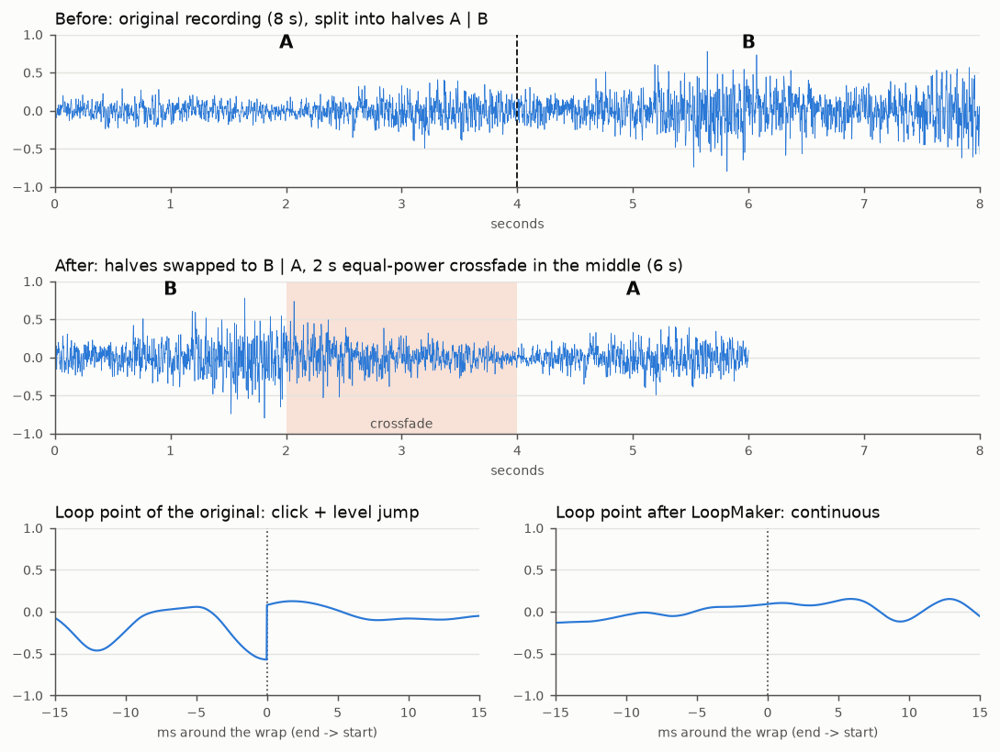

# Loop Maker

> 在 AI 協助下製作：工具設計與演算法需求來自我自己的音效設計工作流程，程式碼由 Claude Code 在我的指示下撰寫。詳見[致謝](#致謝)。

**[⬇ 下載 Windows 版](../../releases/latest)**：不需要安裝 Python。解壓縮後執行 `Loop Maker.exe` 即可。第一次開啟時若出現 Windows SmartScreen 警告，請點「其他資訊」→「仍要執行」。

[English](README.md) | 繁體中文

把環境音（ambience）錄音變成**無縫可循環**的音檔。做法和音效設計師在 DAW 裡手動處理一樣，但可以批次處理，還附品質檢查。



*合成範例（帶有音量漂移的濾波雜訊，見
[`scripts/make_readme_figure.py`](scripts/make_readme_figure.py)）。上：原始檔案。中：Loop Maker 輸出。下：各檔案從結尾繞回開頭時，在循環點聽到的內容。*

## 為什麼需要

遊戲音訊引擎經常循環播放環境音底床。如果錄音直接拿來循環，結尾和開頭很少剛好接得上，每次繞回時會產生爆音（取樣值跳變），也常常聽得出音量或質感的變化。傳統的手動解法是「對調前後半段再交叉淡化」（swap halves and crossfade）。Loop Maker 把這個流程自動化。

## 運作方式

```
original:   [ A ......... | B ......... ]         (在中點切開)
swapped:    [ B ......... | A ......... ]         (舊的結尾與舊的開頭在中間相接)
crossfade:  [ B ....  \/\/\/  .... A ]            (B 的尾巴與 A 的頭重疊)
```

1. 把檔案切成兩半：**A**（前半）和 **B**（後半）。
2. 對調成 **B | A**。新檔案從舊的中點**開始**，並在舊中點之前結束。這兩個取樣點在原始錄音中本來就是相鄰的，所以新的循環點自然是連續的：該處完全沒有剪輯。
3. 現在唯一的接縫在中間，也就是舊結尾接舊開頭的地方。用交叉淡化把它藏起來：B 的最後 *C* 秒淡出，同時 A 的前 *C* 秒淡入。因為這兩段重疊，**輸出會比輸入短 *C* 秒**。
4. 在最開頭與最結尾套用一個很小的選用安全淡化（預設 5 ms）。

### 交叉淡化曲線

| 曲線 | 增益 | 適用於 |
|---|---|---|
| `auto`（預設） | 每個檔案在下面兩種之中自動選一種 | 任何素材，詳見下文。 |
| `equal_power` | sin / cos，`out² + in² = 1` | 不相關的素材：環境音、房間底噪、風、雨。感知響度保持恆定。 |
| `linear` | 直線斜坡，`out + in = 1` | 相關的素材（例如穩定的音調／嗡嗡聲），這類素材用等功率會讓音量多出最多 +3 dB 的凸起。 |

#### `auto` 如何決定

用錯曲線，會讓交叉淡化中段明顯**凹陷**（雜訊用 linear，約 −3 dB）或**凸起**（穩定音調用等功率，約 +3 dB）。`auto` 會測量實際要被交叉淡化的兩段訊號之間的**零延遲相關係數 *r***：也就是檔案結尾與檔案開頭，以它們實際重疊的方式取樣對齊。測量時用 Hann 窗加權，偏重交叉淡化中心（兩邊增益都大的地方），並匯集所有聲道的結果，讓每個聲道使用同一種曲線。

在交叉淡化中心，相對於輸入的總功率，等功率是 `1 + r`，線性是 `(1 + r) / 2`。兩者的誤差（以 dB 計）相等的條件是 `(1 + r)² = 2`，所以門檻是 **r = √2 − 1 ≈ 0.41**：高於它用 `linear`，低於它用 `equal_power`。

它刻意測量相關性，而不是問「這是音調嗎？」：兩個相位差 90° 才相接的嗡嗡聲雖然是音調，但相加的行為像雜訊，所以對它們來說等功率才是正確選擇，而這個測量會得到正確結果。選用的曲線與 *r* 都會出現在每份報告中。

### 響度正規化（批次）

使用 `--normalize -24`（或 GUI 的勾選框），批次中每個輸出都會調到相同的**整合響度**（ITU-R BS.1770-4 / EBU R128，使用
[pyloudnorm](https://github.com/csteinmetz1/pyloudnorm)），所以一組環境音底床進入 Wwise／FMOD／引擎時已經是音量對齊的。

- 在**完成的循環檔**上測量，也就是實際會在遊戲裡播放的音訊。
- 每個檔案只套用一個固定增益。沒有限幅器或壓縮器處理聲音。
- **真峰值上限**（預設 −1 dBTP，以 4 倍過取樣估算）：如果達到目標會超過上限，增益就停在上限，報告會說明該檔案差了幾 dB。若要讓這種檔案與其他檔案保持一致，請調低批次目標值。
- 5.1 檔案依 BS.1770 規定，測量時排除 LFE 聲道。超過 6 聲道的配置、靜音檔案、短於 400 ms 的檔案會以未正規化的方式寫出，並附註記。
- 預設關閉。GUI 預設的 −23 LUFS 目標是 EBU R128 的參考值。請依你專案的素材響度規格選擇。

### 循環品質報告

每個檔案處理完後，Loop Maker 會印出一份簡短報告，比較**原始檔**（假設不加處理直接循環）和**輸出檔**。兩者都在響度正規化之前測量，所以音量可以直接比較：

```
wind_quiet.wav -> output\wind_quiet_loop.wav
  48000 Hz, 2 ch, PCM_24 -> PCM_24, 12.000 s -> 10.000 s
  Crossfade curve: equal_power (auto; end/start correlation +0.02, threshold 0.41)
  Loudness: -31.8 -> -24.0 LUFS (gain +7.8 dB, true peak -10.4 dBTP)
  Loop-point check (window 50 ms): SMOOTH
  original  jump 0.03541 (40.19x typical step)   RMS head/tail  -32.5 /  -32.3 dBFS (diff -0.23 dB)
  loop      jump 0.00000 ( 0.00x typical step)   RMS head/tail  -32.6 /  -31.3 dBFS (diff -1.38 dB)
```

- **jump**：`|第一個取樣 − 最後一個取樣|`（取各聲道最大值），以及該值除以檔案的*典型步階*（相鄰取樣差值的第 99 百分位）。≤ 1x 表示繞回時的跳變不比錄音內部一般的步階大。
- **RMS head/tail**：前後 50 ms（可設定）的音量。差距大代表繞回處會有明顯的音量跳變。
- **判定**：跳變比 ≤ 1.0 且 |RMS 差| ≤ 2 dB 為 `SMOOTH`，否則為 `CHECK BY EAR`（請用耳朵確認）。這些只是簡單的啟發式規則，不是感知模型。

## 安裝

需要 Python 3.10+（在 Windows 11 上以 3.12 開發）。

```bash
python -m venv .venv
```

```bash
.venv\Scripts\activate
```

```bash
pip install -r requirements.txt
```

`tkinterdnd2` 和 `sounddevice` 是選用的；沒有它們時，GUI 會退回使用*加入檔案*／*加入資料夾*按鈕，以及只有波形的測試區。`matplotlib` 和 `pytest` 只有產生圖表和跑測試時才需要。

## Windows 獨立程式（不需要 Python）

給沒有 Python 的人，有現成可執行的版本：`LoopMaker-<version>-win64.zip`。

1. 解壓縮到任何你有寫入權限的地方（桌面、文件；不要放 `Program Files`）。
2. 打開 `Loop Maker` 資料夾，雙擊 **`Loop Maker.exe`**。整個資料夾要放在一起：exe 需要旁邊的 `_internal` 資料夾。
3. 這個程式沒有程式碼簽章，所以第一次啟動時 Windows SmartScreen 可能會顯示「Windows 已保護您的電腦」。點 **其他資訊 → 仍要執行**。

`presets.json` 放在 exe 旁邊，可以直接在那裡編輯。預設輸出資料夾是 exe 旁邊的 `output`。需要 Windows 10/11 64 位元。只包含 GUI；CLI 仍然需要 Python。

**疑難排解：** `"Loop Maker.exe" --selftest selftest.txt` 會檢查所有內含元件（音訊檔案 I/O、重新取樣、響度、播放裝置、拖放、完整批次執行），並把結果寫到 `selftest.txt`。

### 自己建置

```bash
.venv\Scripts\python.exe -m pip install -r requirements-build.txt
```

```bash
.venv\Scripts\python.exe scripts\build_exe.py
```

這會用 PyInstaller 產生 `dist\Loop Maker\` 和 `dist\LoopMaker-<version>-win64.zip`。採用單一資料夾建置而不是單一檔案，因為單一 exe 每次啟動都要解開約 150 MB（啟動慢），也比較容易被防毒軟體誤判。腳本會執行建好的 exe 的 `--selftest`，只要有任何檢查失敗就會失敗，所以壞掉的套件不會被壓縮。套件解壓後約 140 MB（壓縮後 58 MB），主要是 scipy 和 numpy。

## 使用方式

### 命令列

```bash
python -m loopmaker rain.wav forest.flac --crossfade 3.0 --curve equal_power --out output
```

```bash
python -m loopmaker "D:\Recordings\Ambience"
```

| 選項 | 預設值 | 意義 |
|---|---|---|
| `inputs` | （必填） | 檔案和／或資料夾。資料夾以非遞迴方式掃描 `.wav .flac .aif .aiff .ogg`。 |
| `--crossfade SECONDS` | `2.0` | 交叉淡化長度。必須 > 0 且 ≤ 檔案長度的一半。 |
| `--curve` | `auto` | `auto`、`equal_power` 或 `linear`。 |
| `--normalize LUFS` | 關閉 | 把每個輸出調到這個整合響度，例如 `-24`。 |
| `--peak-ceiling DBTP` | `-1` | `--normalize` 使用的真峰值上限。 |
| `--safety-fade MS` | `5` | 開頭／結尾淡化，單位毫秒；`0` 為停用。 |
| `--out FOLDER` | `output` | 輸出資料夾（必要時會建立）。 |
| `--preset NAME` | `Custom` | 輸出預設：`Custom`、`Wwise`、`Unreal`、`Unity`、`Godot`，或 `presets.json` 裡的其中一個。 |
| `--sample-rate`, `--bit-depth`, `--format`, `--dither` | 來源／來源／WAV／auto | Custom 預設的欄位。 |
| `--presets JSON` | `presets.json` | 要載入的預設檔。 |
| `--template`, `--category`, `--suffix` | `{name}_{suffix}`, `AMB`, `loop` | 檔案命名。 |
| `--variations N` | `0`（關閉） | 每個輸入寫出 N = 3..5 個旋轉過的循環變體。 |
| `--min-spacing PCT` | `12` | 變體切點之間的最小距離，佔檔案長度的百分比。 |
| `--short-warning SECONDS` | `15` | 短於這個長度時，警告變體聽起來可能很像。 |
| `--on-problem` | `skip` | `skip`（跳過並記錄）、`clamp`（自動夾限）、`stop`（停止批次）。見*批次驗證*。 |
| `--report TXT` | 關閉 | 同時把批次報告寫成文字檔。 |
| `--dry-run` | 關閉 | 只驗證並預覽輸出檔名，不寫入任何東西。 |
| `--report-window MS` | `50` | 品質報告使用的視窗。 |

處理之前，CLI 會印出每個檔案的狀態（OK／警告／錯誤，附原因）和預計的輸出檔名，接著是摘要行，例如
`12 files: 9 OK, 2 warnings, 1 cannot be processed`。處理之後會印出批次報告。結束代碼：每個檔案都寫出時為 `0`，有任何檔案被跳過、失敗或未執行時為 `1`，設定無效（錯誤的預設、範本……）時為 `2`。

### GUI

在 Windows 上，雙擊專案資料夾裡的 **`Loop Maker.bat`**（它會用專案的 `.venv` 啟動 GUI，不會跳出主控台視窗）。或在終端機裡執行：

```bash
.venv\Scripts\python.exe -m loopmaker.gui
```

把檔案或資料夾拖到 **Files** 表格上（或使用按鈕），設定 **Global settings**，檢查狀態欄和摘要行，然後按 **Process**。GUI 使用的 `batch.validate_batch()` / `batch.run_batch()` 和 CLI 完全相同。

**檔案表格。** 每個檔案一列：

| 欄位 | 意義 |
|---|---|
| ☐ | 勾選列，供*移除所選*與最大交叉淡化提示使用 |
| File, Length, Format | 從檔案標頭讀取（滑鼠移到檔名上可看完整路徑） |
| **Crossfade**, **Var.** | 單檔覆寫。空白 = 使用全域設定。被覆寫的格子會變**黃色**；無效的值會變**紅色**，並讓該列成為錯誤 |
| Output | 範本產生的第一個輸出檔名（`+3` = 還有更多變體；滑鼠移上去可看全部） |
| **Status** | **OK**／**warning**／**error**。滑鼠移上去看原因，例如 *"crossfade 3.0 s exceeds half the file length (1.00 s)"* |
| Progress | queued → processing... → done (N files) / skipped / failed / not run（滑鼠移上去看細節） |

- **即時驗證：**每次更改全域設定或覆寫值，所有列會在約 150 ms 內重新驗證。不需要等到按 Process。
- **最大交叉淡化提示**位於交叉淡化欄位旁邊：適合所有檔案的最長交叉淡化，或只針對勾選的檔案（*"max 1.00 s for 2 selected"*）。它已把變體納入計算。
- **摘要行**位於 Process 旁邊：*"12 files: 9 OK, 2 warnings, 1 cannot be processed"*。
- 執行之後，每列會顯示結果，每個輸出都出現在 *Test playback* 中，記錄區有完整報告，**Export report...** 可以把它存成文字檔。

**試聽（Test playback）。** 處理完後，每個輸出都會連同判定結果出現在 *Test playback* 清單中。選一個就能看波形；交叉淡化區域以橘色標示。

| 操作 | 效果 |
|---|---|
| **Space** 或 **Play/Stop** | 開始／停止循環播放（從停止處繼續） |
| **在波形上左鍵點擊** | 從該點開始播放（已在播放時會跳到那裡） |
| **Play loop point** | 從結尾前 2 秒開始，讓你立刻聽到繞回 |
| **Open output folder** | 在檔案總管中顯示檔案 |

播放時會從最後一個取樣直接繞回第一個，和遊戲引擎的循環聲音一模一樣，所以你聽到的是對循環點的真實測試。單聲道檔案會從兩個喇叭播放；聲道數多於輸出裝置的檔案，只在試聽時混成單聲道（寫出的檔案不受影響）。播放需要選用的 `sounddevice` 套件；沒有它的話波形仍可使用。

**語言。**「開始處理」按鈕旁的**語言**下拉選單（英文介面顯示為 **Language**）可以在 **English** 和**繁體中文**之間切換，介面會立即更新，不需要重開程式，設定也不會改變。選擇會記在 `%APPDATA%\Loop Maker\settings.json`。第一次開啟時，如果 Windows 的顯示語言是繁體中文（zh-TW／zh-HK／zh-MO）就預設中文，其他語言則預設英文。

- 檢查訊息（狀態欄的 tooltip、摘要列、設定問題）由不含 UI 的核心模組以英文產生，再由 `loopmaker/i18n.py` 的對照表翻成中文顯示，核心模組因此不需要處理語言。有一個測試會產生每一種核心訊息，只要有任何一種沒有中文翻譯，測試就會失敗。對照表裡沒有的訊息會直接顯示英文，不會出錯。
- **記錄區和匯出的批次報告刻意維持英文**：和 CLI 的輸出一致，方便分享給團隊。
- 技術名稱兩種語言都維持原文：曲線名稱（`auto`、`equal_power`、`linear`）、預設名稱、*Crossfade*、*Variations*、LUFS／dBTP。

### 作為函式庫

```python
import soundfile as sf
from loopmaker.core import make_loop

audio, sr = sf.read("wind.wav")          # (frames,) or (frames, channels)
looped = make_loop(audio, sr, crossfade_s=3.0, curve="equal_power", safety_fade_s=0.005)
```

## 輸出預設（Output presets）

在 GUI 的 **Preset** 下拉選單或用 `--preset NAME` 選擇預設：

| 預設 | 取樣率 | 位元深度 | 格式 | 抖動（Dither） |
|---|---|---|---|---|
| **Custom**（預設） | 來源／44.1／48／96 kHz | 來源／16／24／32 位元浮點 | WAV／FLAC／OGG | auto |
| **Wwise** | 48 kHz | 24-bit | WAV | auto |
| **Unreal** | 48 kHz | 16-bit | WAV | always |
| **Unity** | 48 kHz | 來源 | WAV | auto |
| **Godot** | 48 kHz | 來源 | WAV | auto |

```bash
python -m loopmaker recordings\ --preset Wwise
```

```bash
python -m loopmaker rain.wav --preset Custom --sample-rate 44100 --bit-depth 16 --format FLAC
```

- **Custom 且所有欄位都設為「來源」**，會重現舊的行為：相同取樣率、相同位元深度、WAV。
- **Unity 和 Godot** 只指定 48 kHz WAV，所以保留來源的位元深度。請確認你的引擎版本能匯入什麼（例如是否支援 24-bit WAV），必要時編輯預設。
- **OGG**（Vorbis）只有在已安裝的 libsndfile 能寫入時才提供。它是有損格式，所以位元深度不適用。**FLAC** 只儲存 16/24-bit；FLAC + 32 位元浮點會被拒絕並附上清楚的訊息。
- CLI 的 `--sample-rate`、`--bit-depth`、`--format` 和 `--dither` 只在 `--preset Custom` 時有效。和具名預設一起使用是錯誤，而不是默默覆寫，所以「Wwise」檔案一定是正確的 Wwise 格式。

### 重新取樣

當預設會改變取樣率時，**來源會先重新取樣，再做循環**，使用多相濾波器（`scipy.signal.resample_poly`，精確的有理數比例，例如 44.1 → 48 kHz 用 160/147，Kaiser 窗 β = 9，約 90 dB 的阻帶衰減）。先重新取樣很重要：濾波器的邊緣暫態會落在原始檔案的開頭和結尾，而這兩處最後會落在交叉淡化內、增益接近零的位置，所以循環點保持乾淨。之後所有長度（交叉淡化、輸出）都以新的取樣率計算。

### 抖動（Dither）

整數 16/24-bit 輸出由 Loop Maker 自己量化（不交給 libsndfile），並可選用 **TPDF 抖動**（±1 LSB 三角分布雜訊）。抖動模式：

- `auto`（預設）：只在位元深度**降低**時才抖動：24 → 16、浮點 → 24 等。16-bit 來源寫成 16-bit 只做四捨五入，不抖動。這是照字面遵循「降低」規則，雖然技術上交叉淡化與增益也會重新量化。
- `always`：每個 16/24-bit 輸出都抖動（Unreal 預設使用）。
- `never`：單純四捨五入。

抖動雜訊以輸出檔名作為種子，所以相同輸入與設定會產生逐位元組相同的檔案，當素材放在版本控制裡時可避免雜亂的差異。過載（overload）是在抖動*之前*計算並回報；抖動本身絕不會讓取樣值溢位繞回。

### 預設檔（`presets.json`）

具名預設存放在專案資料夾的 [`presets.json`](presets.json)，你可以編輯或擴充：

```json
{
  "version": 1,
  "presets": {
    "Wwise": {"sample_rate": 48000, "bit_depth": "24", "format": "WAV", "dither": "auto",
              "description": "48 kHz, 24-bit WAV"}
  }
}
```

`sample_rate` 和 `bit_depth` 可以是 `"source"`。如果檔案不存在或不是有效的 JSON，會改用內建預設，並在 GUI 記錄區或 stderr 顯示警告。單一無效項目會被跳過（警告裡會指名），其餘照常載入。`Custom` 是保留名稱。用 `--presets other.json` 可載入不同的檔案。

## 檔案命名

**Name template** 欄位與 `--template` 用以下標記（token）組出每個輸出的檔名：

| 標記 | 值 |
|---|---|
| `{name}` | 輸入檔名（不含副檔名） |
| `{category}` | Category 欄位／`--category`（預設 `AMB`） |
| `{index}` | 在批次中的位置：`01`、`02` …（100 個檔案以上為 3 位數） |
| `{suffix}` | Suffix 欄位／`--suffix`（預設 `loop`） |

```bash
python -m loopmaker "Desert_Wind.wav" --template "AMB_{name}_{index}_loop"
```

這個指令會寫出 `AMB_Desert_Wind_01_loop.wav`。預設範本 `{name}_{suffix}` 會產生熟悉的 `<name>_loop.wav`。

- **驗證：**未知標記、括號不成對、Windows 禁用字元（`< > : " / \ | ? *`）、以空格或句點結尾的名稱、以及 `CON` 這類保留名稱，都會在處理之前被拒絕。GUI 會在範本欄位下方以紅字顯示原因，CLI 則以代碼 2 結束。
- **預覽：**GUI 即時顯示產生的名稱。CLI 在處理之前會印出每一組 `input -> output` 名稱，`--dry-run` 在預覽後就停止。
- `{name}` 保留原始拼寫（包含空格）；只有非法字元會變成 `_`。
- 範本沒有 `{name}` 或 `{index}` 時會給警告。批次中名稱衝突的檔案會加上 `_2`、`_3` …，確保不會互相覆蓋。

## 循環變體（Loop variations）

**Variations: N**（GUI）或 `--variations N`（CLI，N = 3 到 5）會為每個輸入寫出 N 個循環，而不是一個，並在範本之後加上 `_v01`、`_v02` …（例如 `AMB_Desert_Wind_01_loop_v02.wav`）。

```bash
python -m loopmaker "Desert_Wind.wav" --variations 4 --template "AMB_{name}_{index}_loop"
```

**變體是什麼。**每個變體不是在中點切開，而是在來源的不同位置切開，再套用同樣的對調 + 交叉淡化。從數學上看，每個變體都是**同一個循環旋轉**後的結果（測試用 `np.roll` 驗證這一點）：交叉淡化融合的是同一段原始結尾與開頭，只有檔案開始與繞回的時間點移動了。每個變體各自都能無縫循環。

**切點如何選擇**（`loopmaker/variations.py`）：

1. 對單聲道混音計算短視窗 RMS（50 ms 視窗、10 ms 跳距），並在 200 ms 範圍內平滑。
2. 最響的瞬態會被圍起來排除。高於第 95 百分位**且**比中位數高 6 dB 的視窗，加上兩側各 300 ms，都會被排除，所以變體不會從打擊聲中間開始。
3. 候選點兩側必須各留一個交叉淡化的長度，避開中點（那是標準循環），並且彼此至少相隔**最小間距**：預設為**檔案長度的 12%**，可用 `--min-spacing PCT` 或 GUI 欄位設定。
4. 依平滑後能量的谷底（局部最小值），由最安靜的開始取用。如果間距規則留下的不夠，就用其他允許的位置補上，所以通過長度檢查的檔案一定會得到 N 個變體。

**長度規則：**

- 如果來源長度不大於 `2 × 交叉淡化 + N × 最小間距`，會是**錯誤**。訊息會顯示數字，例如 *"too short for 5 variations: needs more than 2 x 2 s crossfade + 5 x 1.2 s minimum spacing (12% of the file) = 10.0 s, but the file is 10.0 s"*。
- 低於 **15 秒**（`--short-warning SECONDS` 或 GUI 欄位）會有**警告**（仍會處理）：*"variations may sound nearly identical"*。這個門檻是經驗法則。
- 實務上，變體最適合**大約 30 秒或更長**的來源。這同樣是經驗法則，不是標準。

### 在遊戲引擎中使用變體（請閱讀）

變體是同一份素材旋轉後的結果，所以**一個變體的結尾不會自然接到另一個變體的開頭**。只有每個檔案自己的繞回（自己的結尾接自己的開頭）是無縫的。不加轉場就直接接著播 `_v01` 再播 `_v03` 會有跳變。

在 Wwise 裡，把變體放進**設為連續播放（continuous）的 Random Container，並在物件之間設定交叉淡化轉場**，讓每次切換都由交叉淡化蓋住。確切的選項名稱和在 Property Editor 中的位置，依 Wwise 版本而異：**請在 Wwise 裡確認**，不要依賴這裡的措辭。其他引擎的概念相同：只透過交叉淡化在變體之間切換。

## 批次驗證與「On problem」

每個檔案都會**分別**且**在寫入任何東西之前**被驗證（只從標頭判斷，所以是瞬間完成）。檢查項目包括：檔案無法讀取、交叉淡化長於檔案的一半、對要求的變體數太短、來源過短的變體警告、檔案對響度正規化而言太短或聲道太多、輸出檔名衝突、輸出會覆蓋輸入，以及單檔覆寫值無效。

| 狀態 | 意義 |
|---|---|
| **OK** | 沒有需要回報的事 |
| **warning** | 會被處理。警告**永遠不會阻擋**處理 |
| **error** | 依目前設定無法處理。**只阻擋該檔案**，不會阻擋整個批次（*stop* 除外） |

**On problem**（GUI 下拉選單、`--on-problem`）：

- **skip and log**（預設）：有錯誤的檔案被跳過並記錄原因；批次其餘部分照常執行。
- **auto-clamp**：能修的就修，並記錄**每一項**更動，例如
  `Rain_short.wav: crossfade 3.0 -> 1.0 s`。交叉淡化會縮短到該檔案允許的最長值。有變體時，會先縮短交叉淡化，以保留要求的變體。只有在這樣會讓交叉淡化少於 50 ms 時，才會減少變體數量（一路減到「關閉」，即標準循環）。被夾限的檔案會顯示為 **warning**。無法夾限的問題（檔案無法讀取、覆寫值無效）仍是錯誤並被跳過。
- **stop the batch**：依序處理檔案，在第一個無法處理或處理中失敗的檔案處停止。之後的檔案報告為 *not run*。

通過驗證、但處理時仍失敗的檔案（例如期間被刪除）會被回報為 *failed*；在 *skip* 和 *auto-clamp* 之下批次會繼續。

**批次報告**（記錄區、CLI 輸出、*Export report...*、`--report`）：包含設定、執行前摘要，以及每個檔案的：狀態、實際使用的交叉淡化、變體數、每個輸出路徑與其**接縫分數（seam score）**、曲線與響度、夾限更動與警告，或被跳過／失敗的原因。

### 接縫分數（Seam score）

每個輸出一個 0–100 的啟發式分數（不是感知模型），顯示在報告和 Test playback 清單中。從 100 開始，扣除：

- **繞回跳變**每超過一般取樣步階一個單位，扣 25 分，
- 超過 1 dB 之後，**頭尾音量差**每 1 dB 扣 10 分，
- 超過 1 dB 之後，**交叉淡化凹陷／凸起**每 1 dB 扣 10 分。這是交叉淡化中心的音量，相較於它前後音訊的音量，能抓出錯誤的曲線（約 ±3 dB）。

那 1 dB 的容許量，涵蓋環境音在相鄰視窗之間自然的音量起伏。

## 輸出檔案

- 以範本產生的名稱寫到輸出資料夾。**輸入檔絕不會被覆蓋**（寫入前會明確檢查）。
- 聲道數一律保留。取樣率與位元深度除非預設要改，否則保留。
- 位元深度設為「來源」時：PCM 8/16/24/32-bit 與 32/64 位元浮點輸入會保留其子類型。在所選格式中沒有無損對應的輸入（例如 Ogg Vorbis → WAV、浮點 → FLAC）會寫成 24-bit PCM，並在報告中說明。

## 設計決定與預設值

這些是規格有空間時我做的選擇，很容易修改。

- **預設輸出是 WAV**，即使輸入是 FLAC，因為 WAV 是遊戲引擎和中介軟體最直接匯入的格式。FLAC 和 OGG 可透過 Custom 預設使用。
- **預設交叉淡化是 2.0 秒。**長到足以在大多數環境音中藏住接縫，短到可以處理 4 秒以上的檔案。
- **交叉淡化必須 > 0。**0 秒的交叉淡化會在中間留下硬切，違背目的。
- **奇數長度的檔案**：多出來的那個取樣歸 B，所以交叉淡化上限是 `floor(frames / 2)` 個取樣。
- **既有的輸出會被覆蓋**（用新設定重跑是最常見的情況）。同一批次內名稱衝突（例如 `rain.wav` 和 `rain.flac`）會變成 `_loop_2`、`_loop_3` …
- **資料夾以非遞迴方式掃描**，所以輸出資料夾不會被誤當成輸入。
- **削波（Clipping）**：相關素材的等功率交叉淡化，峰值可能超過 0 dBFS。對整數 PCM 輸出，取樣會被削波（而不是讓它溢位繞回），並印出警告。浮點輸出不削波。
- **一個壞檔案不會讓整個批次停下來**；它會被回報，其餘繼續。

### 關於安全淡化的說明

安全淡化是用來防止檔案被*單次*播放或被引擎裁切時的爆音。當檔案被循環時，它也會在循環點造成一個很小的凹陷（預設 2 × 5 ms），因為兩端都被淡化到零。這在環境音底下通常聽不出來，但若要完美的取樣連續循環，請設定 `--safety-fade 0`：演算法本身已經能讓繞回連續。開啟淡化時，報告中的「jump」一律為 0（兩端都是 0），所以 RMS 比較才是資訊量較多的數字。測試是在停用淡化時檢查連續性。

## 專案結構

```
loopmaker/
  core.py       純 numpy DSP：make_loop()、交叉淡化曲線、安全淡化
  quality.py    循環點測量與報告格式化
  loudness.py   BS.1770 響度、真峰值、正規化增益
  convert.py    重新取樣與 TPDF 抖動量化（純 DSP）
  presets.py    輸出預設，載入 presets.json 並有內建後備
  naming.py     檔案命名範本：驗證與渲染
  variations.py 切點選擇（RMS 谷底、間距、長度檢查）
  audio_io.py   soundfile 讀寫、子類型對應、輸入收集
  pipeline.py   檔案層級處理：重新取樣、循環、測量、寫入
  batch.py      單檔驗證、On-problem 策略、批次執行與報告
  preview.py    波形峰值與無縫循環播放（沒有 UI 程式碼）
  cli.py        argparse 前端   (python -m loopmaker)
  gui.py        Tkinter 主視窗  (python -m loopmaker.gui)
  gui_table.py  檔案表格元件：覆寫、狀態、提示、進度
  gui_playback.py  Test playback 面板：輸出清單、波形、試聽
  paths.py      應用程式資料夾／內含資源，從原始碼或 .exe 執行皆可
  selftest.py   所有內含元件的自我測試 (--selftest)
  i18n.py       GUI 翻譯（英文／繁體中文）
assets/         應用程式圖示（由 scripts/make_icon.py 產生）
tests/          使用合成雜訊與正弦訊號的 pytest 測試
scripts/        README 圖表、圖示產生器、exe 進入點與建置腳本
```

## 測試

```bash
python -m pytest
```

測試只使用合成音訊（固定種子的雜訊、正弦波、DC），檢查：輸出長度、繞回點的連續性、交叉淡化過長的錯誤、多聲道行為、格式保留、預設／抖動／重新取樣、命名範本、預設檔後備、循環變體（間距、旋轉、無縫繞回、長度錯誤）、單檔驗證與 On-problem 策略、批次報告，以及 CLI。

## 致謝

在 AI 協助下製作：程式碼是用
[Claude Code](https://claude.com/claude-code)（Anthropic）寫的，由我主導設計、根據我自己的音效設計工作流程制定演算法與需求，並審查結果。

## 授權

[MIT](LICENSE)